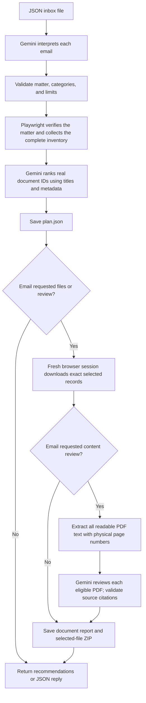

# Senpilot Regulatory Document AI Agent

A Python agent that reads email requests from a local JSON inbox, finds verified matters on the
[UARB website](https://uarb.novascotia.ca/fmi/webd/UARB15), recommends up to ten
documents, and optionally downloads and reviews their PDF text. It produces
JSON replies. Mailbox integration and email
delivery are not implemented.

The requirements are in [the assignment PDF](docs/Co-op%20Technical%20Assignment%20-%20Winter%202027.pdf).
Example matter numbers are inputs, never application defaults.

## Setup

Requires Python 3.12+. Run these PowerShell commands from the repository root:

```powershell
uv venv --python 3.12 .venv
uv pip install --python .venv\Scripts\python.exe -e ".[dev]"
$env:PLAYWRIGHT_BROWSERS_PATH = "$PWD\.cache\ms-playwright"
.\.venv\Scripts\python.exe -m playwright install chromium
if (-not (Test-Path .env)) { Copy-Item .env.example .env }
```

Set `GEMINI_API_KEY` in `.env`. The optional `GEMINI_MODEL` defaults to
`gemini-3.1-flash-lite`. Existing environment variables override `.env`, which
is loaded from the current working directory and ignored by Git. JSON requests
require the Gemini configuration for interpretation and ranking.

Set `PLAYWRIGHT_BROWSERS_PATH` in each new terminal session. Alternatively, pass
`--channel msedge` or `--channel chrome` to use an installed browser.
Runtime dependencies are Playwright, the OpenAI SDK (for Google's compatible
endpoint), Pydantic, python-dotenv, and pypdf. The development dependency is pytest.

## Run the pipeline

Process the [example inbox](examples/emails.json). Each email determines its
requested count and whether to recommend, download, or review documents:

```powershell
.\.venv\Scripts\senpilot-plan.exe --emails-json examples/emails.json
```

The JSON format is:

```json
{
  "emails": {
    "email1": {
      "subject": "M12205 decisions and orders",
      "content": "Review up to three decisions and orders. What conditions did the Board impose?"
    }
  }
}
```

Output is `artifacts/<batch-run>/replies.json`, with the same email IDs and
`subject`/`content` fields. Replies include selection reasons, findings, physical
PDF page citations, limitations, and local file paths when available. Each email
gets its own workflow directory. Emails run in order; replies are saved after
each completes, and a failed email does not prevent the next from running.
Extra fields, duplicate keys, empty inboxes, and blank IDs/subjects/bodies are
rejected before browser or AI work. Local paths serve as attachment references.

Use the same JSON shape for a single email or a batch. The runner requires a
UTF-8 JSON file; there are no plain-text, standard-input, or direct-matter modes.

The first model call extracts `requested_count`, `download_requested`, and
`review_requested`, alongside the matter and document criteria. A request for
files or a ZIP enables downloads; content questions or analysis enable PDF text
review as well. Metadata-only emails do neither. Mixed inboxes can use all three
paths independently, with no extra model call to choose the mode.

The JSON runner supports `--output PATH`, `--headed`, `--channel chrome|msedge`,
`--timeout-ms 30000` (range 1000-120000), and `--inspect-seconds 0` (range 0-60).
The email supplies the requested count, subject to the application's maximum of ten; an unspecified
count defaults to ten. The model cannot raise this ceiling or select browser,
timeout, output-path, or execution settings.
Use one explicitly written matter number: `M` followed by five ASCII digits.
Missing, multiple, contradictory, or unsupported requests return clarification.

## Five-minute demo

For a rehearsed presentation, see the [five-minute headed demo](examples/demo/README.md).
It includes a one-PDF hero email, two other real matters, edge-case inboxes, and
a presentation sequence that shows prepared results while a fresh visible-browser
run proceeds. The email-driven hero rehearsal completed in 62.47 seconds on October 27, 2026;
fresh live timing still depends on Gemini and UARB. Local prepared outputs, when
present, are indexed in [the demo results](artifacts/demo/READY.md).

## How it works



Steps run sequentially. The request handler waits for the complete inventory
before ranking, all download attempts before extraction, and each PDF's
extraction and review before starting the next. `async`/`await` allows waiting
for browser/API work; it does not make these steps parallel.

| Module | Responsibility |
|---|---|
| `plan_cli.py` | Read a JSON inbox file, call the workflow, print output paths and exit status |
| `email_flow.py` | Validate the inbox, process each subject/body, format replies from existing results |
| `planner.py` | Interpret and validate the request, collect inventory, rank candidates, save the plan, optionally start review |
| `probe.py` | Start a restricted Playwright browser, search and verify the matter, read metadata/counts, dispatch listing or downloads, capture evidence |
| `inventory.py` | Traverse complete virtual grids; merge identical number/title/date records across categories |
| `downloads.py` | Select categories, recheck selected record identities, open download dialogs, save checked files |
| `files.py` | Safe filenames, basic format checks, SHA-256 checksums, checked ZIP creation |
| `content.py` | Extract PDF text in a disposable process with bounded time and size |
| `review.py` | Prepare source excerpts, call Gemini, validate citations, save reports and the selected-document ZIP |

The browser verifies the returned read-only matter number, then reads metadata
and counts for Exhibits, Key Documents, Other Documents, Transcripts, and
Recordings. Omitting categories searches all five; decisions/orders are topics,
not inferred category restrictions. Missing widgets, mismatched identifiers,
invalid counts, and incomplete inventories fail visibly. Inventories exceeding
1,000 candidates require narrower categories. Browser network traffic is
restricted to the UARB origin; the model never controls the browser.

Gemini first sees the email text, then the validated request and complete real
inventory. Ranking rejects unknown or repeated candidate IDs, empty reasons,
and selections above the result limit. An empty inventory skips ranking; an
empty shortlist skips downloads and content review. The shortlist remains based
on metadata even when content review is enabled.

Review downloads use a fresh browser session, reverify the matter and counts,
and match each selected number/title/date exactly. Shared records download once;
missing, changed, or ambiguous records fail without substitutes. File checksums
are checked again before review and ZIP creation.

PDF extraction limits are 20 MiB, 100 pages, 100,000 extracted characters,
10 MiB of decoded content per page, and a 60-second process deadline. Encrypted,
corrupt, unsupported, over-limit, and partially unreadable files remain explicitly
unreviewed. OCR, images, diagrams, and visual layout are outside the review scope.

When review is requested, each eligible PDF gets one logical Gemini review using excerpts covering all its extracted
text. The model cites stable source IDs; the application resolves them to local
quotations and physical page numbers, then checks the evidence before publishing
up to five findings. Citation checks establish traceability; human judgment is
still needed to assess interpretations. Rejected output stays diagnostic data.
Calls use the configured Gemini model through Google's OpenAI-compatible
endpoint, structured output, low reasoning effort, and a 60-second deadline per
attempt. Temporary HTTP 429/500/502/503/504 errors, connection failures, and
timeouts get at most three attempts with 5/15-second backoff. `Retry-After`
seconds and HTTP dates are respected; cooldowns over 120 seconds stop for a later
resume. Refusals, malformed output, invented IDs, and invalid citations are not
automatically retried. The configured model is retained; there is no model fallback.

## Retry and resume

Review-mode downloads retry temporary timeouts in fresh browser sessions. Closing
the timed-out session cancels its pending requests. Each new session verifies the
matter and exact selected number/title/date again. Each file gets at most three
attempts, with 5 seconds before the first recovery session and 15 seconds before
subsequent sessions. Unattempted files go ahead of a stalled file, so one failed
download cannot block the rest. Changed, missing, and ambiguous identities fail
without retries or substitutes. Checkpoint resume remains an internal Python
capability for integrations and controlled tests; it has no separate CLI command.
It retains the original request, inventory, shortlist, count, and execution mode.

Checkpoints are replaced atomically after interpretation, complete inventory
collection, each successful download, extraction, and each reviewed document.
Completed planning stages are skipped. Verified files and compatible completed
reviews are reused; only unfinished work invokes the browser or Gemini. Download
checksums, extraction checksums/source bindings, and quotation/page citations are
validated before reuse. Changed or missing local evidence is rebuilt; paths outside
the run and symlinks/junctions are not followed. Older reports without extraction
checksums keep their valid downloads but rebuild extraction and content review.

Existing ZIPs are reused only if they exactly match the verified files; when the
file set changes, a new uniquely named ZIP is created and the old ZIP is retained.
The current `GEMINI_MODEL` setting applies to unfinished calls, while completed
reviews and their original per-call model diagnostics remain saved. API keys are
never stored. New `plan.json` checkpoints include the original email text so an
interrupted interpretation can resume; treat output directories as private data.

## Outputs and failures

Each workflow creates a unique directory under `artifacts/`:

| Output | Contents |
|---|---|
| `plan.json` | Interpreted request, metadata/counts, complete inventory, selections, model/call diagnostics |
| `browser/<run>/` | Inventory browser JSON report, page text, and Playwright trace |
| `downloads/` | Successfully validated selected files with unique safe filenames |
| `extracted/<candidate_id>.json` | Text by physical page, extraction status, and coverage warnings |
| `review.json` | Final per-document download/extraction/review results, citations, checksums, errors, and workflow status |
| `review.md` | Readable findings and local file/page links |
| `<matter>_selected_documents.zip` | Successful selected downloads, including files whose review failed |
| `retrieval_browser/<run>/` | Separate evidence from the fresh retrieval session |

Document outputs (`review.json`, `review.md`, downloads, and ZIP) are created when
the email requests downloads or review. For a
download-only request, the report explicitly says contents were not reviewed;
there is no extraction or content-model call. No empty document ZIP is written.
`plan.json` records the original selection; use `review.json` to determine whether
retrieval and content review actually completed. Completed work is preserved on
partial failure, and failed reviews never become metadata summaries.

Exit codes: `0` for completion (including no matches), `2` for invalid input or
clarification, `1` for failures or partial completion. A JSON batch exits `1` if
any email fails, otherwise `2` if any needs clarification, otherwise `0`. It has
no automatic batch resume. Saved progress remains available to the internal resume function.
An output-writing failure also exits `1`.

## Diagnostics and internal functions

Each browser session writes `report.json`, `page.txt`, and `trace.zip`; standalone
HTML dumps and PNG screenshots are not saved. To view a captured trace:

```powershell
.\.venv\Scripts\python.exe -m playwright show-trace artifacts\RUN_DIRECTORY\trace.zip
```

The single user entry point is `senpilot-plan --emails-json PATH`. Internally,
`process_emails` validates the inbox and calls `plan_email` for each message.
`resume_email` and browser/download helpers remain reusable implementation
functions for future integrations and tests, rather than additional user commands.

## Verification and local files

```powershell
.\.venv\Scripts\python.exe -m pytest -q
```

Tests use offline browser fixtures, generated PDFs, and mocked Gemini responses.
They cover inventory completeness, exact selected downloads, extraction limits,
citation validation, partial failures, inbox processing, and end-to-end flows.
The tests cover per-email action/count inference, download-only ZIPs,
interrupted-run resume, bounded retries, changed evidence, prompt upgrades,
fresh-session downloads, and rejection of removed input modes.
Live acceptance succeeded on October 27, 2026, for M12205 across all five
categories: 56 unique candidates, four selected PDFs downloaded and reviewed
(38 physical pages), and a verified four-file ZIP. Transient Gemini 503s recovered
through the bounded retries without changing models. Content review was then
regenerated with stricter actor/date grounding instructions using the saved PDFs
and extraction. Completed-run resume made zero new API calls or retrieval sessions
and preserved the archive hash. Local evidence is in
`artifacts/20261027T190052Z_9c9711f4/verification.json` and `review.json` (ignored by
Git). File and citation checks establish traceability; AI interpretations still
require human judgment.

`src/`, `tests/`, `examples/`, and the assignment PDF support the pipeline and its
verification. `.env` holds local credentials; `.venv/` and
`.cache/ms-playwright/` hold the local runtime. `artifacts/`, `.pytest_cache/`,
`__pycache__/`, and installer caches are disposable and ignored by Git. Old run
artifacts and investigation logs are not required; new runs recreate outputs.
