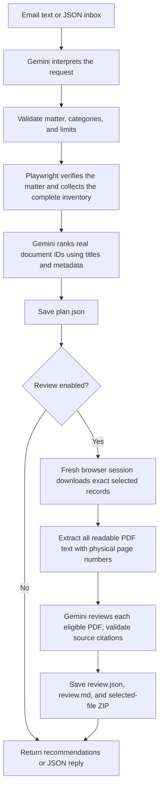

# Senpilot Regulatory Document AI Agent

A Python CLI that interprets document requests, finds verified matters on the
[UARB website](https://uarb.novascotia.ca/fmi/webd/UARB15), recommends up to ten
documents, and optionally downloads and reviews their PDF text. It also accepts
a local JSON inbox and produces JSON replies. Mailbox integration and email
delivery are not implemented.

The requirements are in [the assignment PDF](docs/Co-op%20Technical%20Assignment%20-%20Winter%202027.pdf).
Example matter numbers are inputs, never application defaults.

## Setup

Requires Python 3.12+. Run these PowerShell commands from the repository root:

```powershell
uv venv --python 3.12 .venv
uv pip install --python .venv\Scripts\python.exe -e ".[dev]"
$env:PLAYWRIGHT_BROWSERS_PATH = "$PWD\.cache\ms-playwright"
.\.venv\Scripts\python.exe -m playwright install chromium
if (-not (Test-Path .env)) { Copy-Item .env.example .env }
```

Set `GEMINI_API_KEY` in `.env`. The optional `GEMINI_MODEL` defaults to
`gemini-3.1-flash-lite`. Existing environment variables override `.env`, which
is loaded from the current working directory and ignored by Git. Inspection and
explicit category downloads work without an API key.

Set `PLAYWRIGHT_BROWSERS_PATH` in each new terminal session. Alternatively, pass
`--channel msedge` or `--channel chrome` to use an installed browser.
Runtime dependencies are Playwright, the OpenAI SDK (for Google's compatible
endpoint), Pydantic, python-dotenv, and pypdf. The development dependency is pytest.

## Run the pipeline

Process the [example inbox](examples/emails.json), downloading and reviewing up
to three selected documents per email:

```powershell
.\.venv\Scripts\senpilot-plan.exe --emails-json examples/emails.json --review --limit 3
```

The JSON format is:

```json
{
  "emails": {
    "email1": {
      "subject": "M12205 decisions and orders",
      "content": "Review up to three decisions and orders. What conditions did the Board impose?"
    }
  }
}
```

Output is `artifacts/<batch-run>/replies.json`, with the same email IDs and
`subject`/`content` fields. Replies include selection reasons, findings, physical
PDF page citations, limitations, and local file paths when available. Each email
gets its own workflow directory. Emails run in order; replies are saved after
each completes, and a failed email does not prevent the next from running.
Extra fields, duplicate keys, empty inboxes, and blank IDs/subjects/bodies are
rejected before browser or AI work. Local paths serve as attachment references.

For a single request, create a UTF-8 text file and run:

```powershell
.\.venv\Scripts\senpilot-plan.exe --email-file request.txt --review --limit 3
```

Omit `--review` for recommendations based on titles and metadata only. Content
questions require `--review`. Both input options accept `-` for standard input:

```powershell
Get-Content -Raw examples/emails.json | .\.venv\Scripts\senpilot-plan.exe --emails-json - --review
```

Both commands support `--output PATH`, `--headed`, `--channel chrome|msedge`,
`--timeout-ms 30000` (range 1000-120000), and `--inspect-seconds 0` (range 0-60).
`--limit` is 1-10, defaulting to 10; the email's requested count also caps results.
Use one explicitly written matter number: `M` followed by five ASCII digits.
Missing, multiple, contradictory, or unsupported requests return clarification.

## How it works



Steps run sequentially. The request handler waits for the complete inventory
before ranking, all download attempts before extraction, and each PDF's
extraction and review before starting the next. `async`/`await` allows waiting
for browser/API work; it does not make these steps parallel.

| Module | Responsibility |
|---|---|
| `plan_cli.py` | Read text or JSON input, call the workflow, print output paths and exit status |
| `email_flow.py` | Validate the inbox, process each subject/body, format replies from existing results |
| `planner.py` | Interpret and validate the request, collect inventory, rank candidates, save the plan, optionally start review |
| `probe.py` | Start a restricted Playwright browser, search and verify the matter, read metadata/counts, dispatch listing or downloads, capture evidence |
| `inventory.py` | Traverse complete virtual grids; merge identical number/title/date records across categories |
| `downloads.py` | Select categories, recheck selected record identities, open download dialogs, save checked files |
| `files.py` | Safe filenames, basic format checks, SHA-256 checksums, checked ZIP creation |
| `content.py` | Extract PDF text in a disposable process with bounded time and size |
| `review.py` | Prepare source excerpts, call Gemini, validate citations, save reports and the selected-document ZIP |
| `cli.py` | Standalone inspection, matter lookup, or category downloads through `senpilot-probe` |

The browser verifies the returned read-only matter number, then reads metadata
and counts for Exhibits, Key Documents, Other Documents, Transcripts, and
Recordings. Omitting categories searches all five; decisions/orders are topics,
not inferred category restrictions. Missing widgets, mismatched identifiers,
invalid counts, and incomplete inventories fail visibly. Inventories exceeding
1,000 candidates require narrower categories. Browser network traffic is
restricted to the UARB origin; the model never controls the browser.

Gemini first sees the email text, then the validated request and complete real
inventory. Ranking rejects unknown or repeated candidate IDs, empty reasons,
and selections above the result limit. An empty inventory skips ranking; an
empty shortlist skips downloads and content review. The shortlist remains based
on metadata even when content review is enabled.

Review downloads use a fresh browser session, reverify the matter and counts,
and match each selected number/title/date exactly. Shared records download once;
missing, changed, or ambiguous records fail without substitutes. File checksums
are checked again before review and ZIP creation.

PDF extraction limits are 20 MiB, 100 pages, 100,000 extracted characters,
10 MiB of decoded content per page, and a 60-second process deadline. Encrypted,
corrupt, unsupported, over-limit, and partially unreadable files remain explicitly
unreviewed. OCR, images, diagrams, and visual layout are outside the review scope.

Each eligible PDF gets one Gemini call using excerpts covering all its extracted
text. The model cites stable source IDs; the application resolves them to local
quotations and physical page numbers, then checks the evidence before publishing
up to five findings. Citation checks establish traceability; human judgment is
still needed to assess interpretations. Rejected output stays diagnostic data.
Calls use the configured Gemini model through Google's OpenAI-compatible
endpoint, structured output, low reasoning effort, a 60-second deadline, and no
automatic retries or model fallback.

## Outputs and failures

Each workflow creates a unique directory under `artifacts/`:

| Output | Contents |
|---|---|
| `plan.json` | Interpreted request, metadata/counts, complete inventory, selections, model/call diagnostics |
| `browser/<run>/` | Inventory browser report, DOM, screenshots, and Playwright trace |
| `downloads/` | Successfully validated selected files with unique safe filenames |
| `extracted/<candidate_id>.json` | Text by physical page, extraction status, and coverage warnings |
| `review.json` | Final per-document download/extraction/review results, citations, checksums, errors, and workflow status |
| `review.md` | Readable findings and local file/page links |
| `<matter>_selected_documents.zip` | Successful selected downloads, including files whose review failed |
| `retrieval_browser/<run>/` | Separate evidence from the fresh retrieval session |

Review outputs are created with `--review`; no empty document ZIP is written.
`plan.json` records the original selection; use `review.json` to determine whether
retrieval and content review actually completed. Completed work is preserved on
partial failure, and failed reviews never become metadata summaries.

Exit codes: `0` for completion (including no matches), `2` for invalid input or
clarification, `1` for failures or partial completion. A JSON batch exits `1` if
any email fails, otherwise `2` if any needs clarification, otherwise `0`. It has
no automatic resume. An output-writing failure also exits `1`.

## Inspect or download without AI

```powershell
.\.venv\Scripts\senpilot-probe.exe --matter M12205
.\.venv\Scripts\senpilot-probe.exe --matter M12205 --category "Other Documents" --limit 3
.\.venv\Scripts\senpilot-probe.exe --headed --inspect-seconds 30
```

Lookup stops after verified matter metadata and all category counts. Adding
`--category` downloads the first requested records in website order and creates
a checked ZIP. Omitting `--matter` captures the page for inspection. Each run
writes `report.json` and browser evidence under `artifacts/`. To view a trace:

```powershell
.\.venv\Scripts\python.exe -m playwright show-trace artifacts\RUN_DIRECTORY\trace.zip
```

The reusable async API is `senpilot_agent.planner.plan_email(email_text,
Path("artifacts"), limit=10, review=True)`, returning `(directory, report)`.
Without the installed entry points, run `python -m senpilot_agent.plan_cli` or
`python -m senpilot_agent.cli` from the virtual environment.

## Verification and local files

```powershell
.\.venv\Scripts\python.exe -m pytest -q
```

Tests use offline browser fixtures, generated PDFs, and mocked Gemini responses.
They cover inventory completeness, exact selected downloads, extraction limits,
citation validation, partial failures, inbox processing, and end-to-end flows.
Live lookup, full metadata planning, selected downloads, and individual PDF
reviews have succeeded in prior runs. Complete fresh live content-review
acceptance remains unverified: previous attempts encountered Gemini HTTP 503
responses and UARB download timeouts.

`src/`, `tests/`, `examples/`, and the assignment PDF support the pipeline and its
verification. `.env` holds local credentials; `.venv/` and
`.cache/ms-playwright/` hold the local runtime. `artifacts/`, `.pytest_cache/`,
`__pycache__/`, and installer caches are disposable and ignored by Git. Old run
artifacts and investigation logs are not required; new runs recreate outputs.
