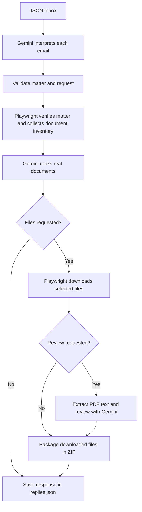

# Senpilot Regulatory Document AI Agent

A Python agent that turns email requests into document recommendations, downloads,
and cited PDF text reviews from the [UARB website](https://uarb.novascotia.ca/fmi/webd/UARB15).
Gemini interprets each request and ranks real documents; Playwright navigates the
website and retrieves the selected files.

Requests come from a local JSON inbox, with replies saved as JSON. Each email can
request up to ten documents for one matter, with downloads and reviews determined
by its wording. Reviews cover extracted PDF text, without OCR or visual analysis.
Gmail integration and email delivery are not implemented.

## Architecture



See the [detailed sequence diagram](docs/architecture-sequence.md) for component
interactions, validation, and failure handling.

## Setup

Requires Git and Python 3.12+. Run these commands in PowerShell:

```powershell
git clone https://github.com/Taha-M567/Senpilot_OA.git
cd Senpilot_OA
python -m venv .venv
.\.venv\Scripts\python.exe -m pip install -e .
$env:PLAYWRIGHT_BROWSERS_PATH = "$PWD\.cache\ms-playwright"
.\.venv\Scripts\python.exe -m playwright install chromium
if (-not (Test-Path .env)) { Copy-Item .env.example .env }
```

Add your Gemini API key to `.env`:

```dotenv
GEMINI_API_KEY=your-key-here
GEMINI_MODEL=gemini-3.1-flash-lite
```

The model is optional and defaults to the value above. `.env` loads from the
current working directory and is ignored by Git; existing environment variables
take precedence. Set `PLAYWRIGHT_BROWSERS_PATH` again in each new terminal session.

## Run

Try the one-document demo with a visible browser:

```powershell
.\.venv\Scripts\senpilot-plan.exe --emails-json examples/demo/hero.json --headed
```

For your own requests, create a UTF-8 JSON file with this structure and pass its
path to `--emails-json`:

```json
{
  "emails": {
    "request1": {
      "subject": "M12205 decisions and orders",
      "content": "Review up to three decisions and orders. What conditions did the Board impose?"
    }
  }
}
```

Include one explicit matter number per email. Omit `--headed` to run the browser
in the background; use `--output PATH` to choose an output folder. Run
`.\.venv\Scripts\senpilot-plan.exe --help` for the remaining browser options.

Open `artifacts/<batch-run>/replies.json` for the results, findings, page citations,
and local attachment paths. Each email has its own subfolder containing its plan,
browser evidence, and any downloaded files, extracted text, review data, and ZIP.
A ZIP is created only when files were downloaded successfully.

## Docs

- [Detailed architecture and request sequence](docs/architecture-sequence.md)
- [Five-minute demo and example requests](examples/demo/README.md)
- [Assignment requirements](docs/Co-op%20Technical%20Assignment%20-%20Winter%202027.pdf)
