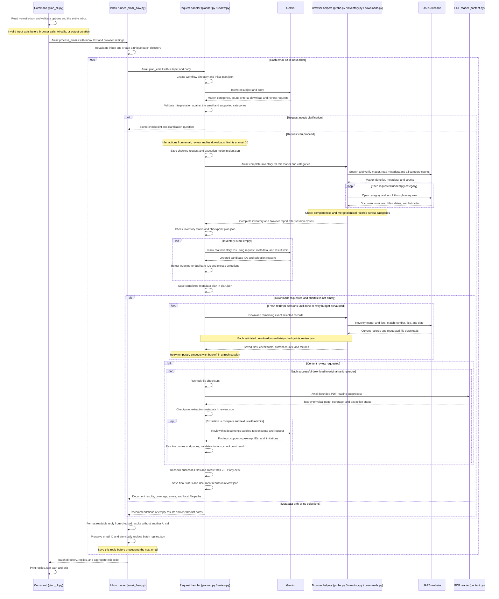

# Request sequence diagram

This describes the current JSON inbox workflow. Solid arrows hand work to another
part, dashed arrows return results, and each caller waits for the result before
continuing. Emails, downloads, and document reviews run sequentially.

The command is `senpilot-plan --emails-json PATH`. Count, downloads, and review
come from each email's wording. Metadata-only requests stop after ranking.
Download-only requests retrieve files and create a ZIP without extraction or
content-review calls. Review requests also extract and review eligible PDFs.

The diagram shows the normal path and request clarification. Inventory errors or
incomplete lists stop that email before ranking. Other ordinary processing errors
become failure replies, and the next email still runs. Individual download or
review failures preserve completed work and are reported in the reply. A failure
to write `replies.json` stops the batch. Exit codes are `0` for completion, `2`
for clarification, and `1` for failures or partial results, with failures taking
precedence across the batch.

Gemini calls allow at most three attempts for transient service failures, with
5/15-second backoff and bounded `Retry-After` handling. Selected-file timeouts
close the browser session and get at most three attempts per file. Unattempted
files go before stalled files in recovery sessions. Changed, missing, or ambiguous
records are not substituted. Unsupported or incomplete PDF extraction skips the
content-model call, and rejected citations are not published as findings.

`replies.json` is the readable output and includes findings, quotes, physical PDF
page citations, coverage warnings, failures, and local file/ZIP paths when
available. `plan.json`, `review.json`, and `extracted/*.json` are internal
checkpoints. Browser diagnostics are JSON reports, page text, and Playwright
traces. There are no standalone HTML/PNG captures or generated Markdown review
reports. The runner reads and writes local JSON files and does not send email.

Checkpoint resume is available through the internal `resume_email()` Python API,
not through a CLI option. It verifies saved evidence and reuses completed work.
