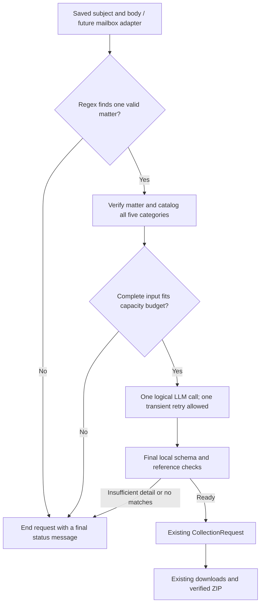

# Plan: rank requested UARB documents with one LLM call

Status: implementation added; real-provider acceptance/evaluations remain pending
the user's deferred API-key configuration. This document records the agreed
architecture and completion gates. See `selection-investigation.md` for evidence.
Starting point: `2f490a5`, with verified priority-driven downloads and ZIP creation.
This decision supersedes the separate intent-extraction/ranking workflow in
`document-selection-plan.md`. Email intake and delivery remain last.

Revision: requests are independent, one-shot jobs. There is no clarification
conversation, follow-up-email matching, or pending request waiting for a reply.
Agreed refinements: complete-catalog input within an explicit capacity budget,
an informative written-document overview by default, and one bounded retry for
transient provider failures.

## Decision and boundaries

Use one logical model request to interpret the user's email and select/rank
documents from an observed UARB catalog. There is no intermediate LLM intent object, second
ranking call, model-driven tool loop, or human approval step. Retain one local
execution-boundary check before constructing the existing `CollectionRequest`.

For an eligible job, use one ranking stage, normally one generation attempt,
with at most one retry for a transient transport/provider failure (two attempts
total). Jobs with an invalid matter, an incomplete/oversized catalog, no public
candidates, or missing model
configuration can finish with zero calls and an explicit outcome. Disable SDK
automatic retries so the adapter owns this bound. A refusal, incomplete response,
or invalid selection must not cause a repair call, fallback model, or a first-10
substitution. A transient retry repeats the same request; it does not add another
interpretation or ranking stage.



## 1. Accept email text without building mailbox integration

Add a local request file containing `subject` and `body_text`. A future mailbox
adapter will decode MIME/HTML and populate the same interface; sender/reply
addresses and message IDs remain transport metadata outside the model input.

Example (illustrative request, not live document metadata):

```json
{
  "subject": "Orders and filings for M12205",
  "body_text": "Please send up to 10 documents from M12205. Prioritize Board Orders, then compliance filings. Exclude confidentiality undertakings and prefer recent documents."
}
```

For initial development, the file contains the current request only. Do not look
up previous messages, recover missing details from a conversation, or maintain
reply-thread state. Mailbox authentication, polling, and sending are deferred.

## 2. Gate the workflow on the matter number only

Add `extract_matter_number(subject, body_text)` before any browser or model work.
Use an ASCII, case-insensitive regex for a complete `M[0-9]{5}` token, normalize
to uppercase, and deduplicate repeated references to the same matter. Require
token boundaries so values such as M122055 or XM12205 do not supply a partial
match. The existing CLI's `matter_argument()` validates a supplied argument; it
does not yet extract a matter number from email text.

| Regex result | Action |
|---|---|
| Exactly one distinct valid matter | Verify that matter and collect its catalog |
| No valid matter | End as `invalid_request`; invoke no LLM |
| More than one distinct valid matter | End as `invalid_request`; invoke no LLM, because a collection job handles one matter |
| The same valid matter appears several times | Treat it as one matter |

A final invalid-request message can say: "Submit a new request containing one
valid matter number, for example M12205." This closes the job; it is not a
question or an invitation to resume it. A later submission is a new request.

Do not require or extract a UARB category before the model call. Category intent,
subtypes such as orders, exclusions, quantity, dates, and priority are interpreted
together by the single LLM call. This removes the category-routing restriction
from the previous revision of this plan.

## 3. Build a complete catalog, without downloading documents

Reuse verified matter search/metadata/counts in `probe.py`, and extend the
category/virtual-scroll operations in `retrieval.py` with catalog enumeration.
The current `find_document()` locates a known reference; it is not a complete
catalog exporter.

For each row, capture:

- An opaque job-local `candidate_id` and its canonical download reference.
- Matter/category, displayed number or hearing date, title or witness fields.
- Displayed document date, extension, security label, and listing position when
  those fields exist; retain raw text and mark unavailable values explicitly.
- Whether the row can be uniquely addressed by the current downloader.

Preserve the meaning of the site's date label, such as Date Filed or hearing
date; do not relabel it as a file creation date. Filenames obtained only through
download dialogs and downloaded file sizes are not assumed to be catalog fields.

Enumerate metadata across all five categories of the verified matter, so the LLM
can infer category intent without an earlier model call. This is a catalog of
publicly listed metadata, not a download of every file. Traverse all
virtual rows, deduplicating recycled DOM observations using stable row/reference
data and list positions. A list position proves snapshot coverage; it must not
become the document's download identity. Repeated hearing dates are distinct rows
and need distinguishing title/witness information.

Reconcile per-category row coverage with the live counts before selection, then
mark private or unaddressable rows ineligible. Preserve all five category counts
independently of eligibility. Duplicate numeric references across categories
must not become two downloadable selections. If the list changes during
enumeration, identifiers conflict, or coverage cannot be established, report
`catalog_incomplete` and stop before the model call.

Persist the full catalog and its fingerprint. Give the model a compact catalog
of eligible, uniquely addressable rows with the original metadata. Confirm new
field selectors from the live site; do not invent dates/extensions for layouts
that do not expose them.

Historical live observations include 62 listed documents for M12205 and 331 for
M12451 (the latter rechecked on October 25, 2026). These examples establish
neither a typical matter size nor a maximum. During implementation, measure
enumeration time and the compact serialized catalog's token size before choosing
the initial input budget; document counts alone do not determine model capacity.

The October 25 inspection showed up/down controls beside identifiers and security,
and file-extension filters on Exhibits and Other Documents. No relevance sort was
observed in the inspected layouts; date sorting and the arrows' behavior are not
yet verified. Do not depend on website relevance ordering or use display order
to select a first-X shortlist. Sorting may aid enumeration only after its
behavior and completeness implications are verified.

## 4. Make the single structured model request

The first provider adapter will use OpenAI Responses with strict JSON Schema in
`text.format`. Keep the model name configurable and select a model supporting
that schema during implementation. The official documentation describes this
response format and the need to handle refusals/incomplete responses separately:
[Structured Outputs](https://developers.openai.com/api/docs/guides/structured-outputs).

Use the official Python SDK as an optional LLM dependency. Keep ordinary
inspection/download commands usable without it, and preserve lazy imports.
Use a server-side API key from configuration, an explicit request timeout, and
bounded output. Do not introduce an agent framework, embeddings store, or database.

The implementation keeps the model explicit in `SENPILOT_LLM_MODEL`. The README
uses `gpt-6-luna` as an initial candidate: its official model page lists Responses
and Structured Outputs support. Its account access and request-selection quality
still require live evaluation; no automatic model fallback is configured.

The adapter may retry once after a short bounded delay for a temporary connection
failure, timeout, retryable rate limit, or temporary server error. Distinguish a
retryable rate limit from an exhausted quota. Invalid credentials, malformed API
requests, exhausted quota, refusals, completed but unusable selections, and
incomplete model responses end the job without a retry. Keep the model, email,
catalog, instructions, and schema unchanged between attempts. Record each
attempt and its outcome. A timeout may occur after the provider processed the
first attempt, so a retry can incur another charge; two attempts is a hard bound.

Supply fixed instructions separately from the email and catalog data. In the
same call, the model must:

1. Interpret explicit or implied UARB categories, likely document subtypes,
   quantity, requested order, exclusions, dates/topics, and whether "only" or
   "prefer" allows other eligible documents.
2. Match those instructions against supplied candidate metadata.
3. Return at most the requested limit (maximum 10), in preferred order, with a
   concise selection reason and matching metadata evidence for each candidate.
4. Return a terminal `insufficient_detail` or `no_matches` result when appropriate.
   Do not ask follow-up questions. A vague title is not proof of document contents;
   do not invent full-text knowledge.

Category and default policy:

- If a category is explicit, respect it, including exclusions such as "no
  Recordings." A subtype is not automatically the Key Documents category.
- If categories are omitted but the email asks for orders/compliance filings or
  other recognizable material, infer likely categories from the request and real
  candidate metadata. Rank matching candidates across those categories.
- If the email simply requests documents for the matter, default to an informative
  overview drawn from Exhibits, Key Documents, and Other Documents, up to the
  requested limit (10 by default). Exclude Transcripts and Recordings from this
  default unless requested explicitly or clearly implied. Record the overview
  assumption and explain the selected documents' purposes using listing metadata.
- If contradictory or insufficient instructions cannot support a defensible
  selection, end the job with a message asking for a new, more detailed request.
  Never create a pending conversation or ask the model for clarification.

For the overview default, prefer complementary documents that explain the matter:

| Purpose, in preferred order | Likely useful listing metadata |
|---|---|
| Outcome and reasons | Decisions, reasons, and substantive orders |
| Original proposal | Application and major amendments |
| Supporting or opposing material | Substantive evidence, reports, and submissions |
| Implementation and follow-through | Compliance filings and implementation directions |
| Administration of the proceeding | Hearing notices, scheduling letters, and routine correspondence |

This is a preference for useful coverage, not a quota per purpose or category.
Favor complementary purposes over apparently repetitive procedural documents;
the Key Documents category alone does not establish informativeness. Skip
purposes with no eligible candidates, such as a decision in an ongoing matter.
An older application or decision may outrank recent routine correspondence.
Recency breaks ties between similarly informative candidates, followed by stable
reference ordering; unknown dates follow known dates. These are metadata-based
judgments, not claims about unread document contents. Explicit requested scope,
references, ordering, and exclusions take precedence over the overview default.

Example response shape (opaque IDs are illustrative):

```json
{
  "status": "ready",
  "matter_number": "M12205",
  "categories": ["Key Documents", "Other Documents"],
  "category_basis": "inferred",
  "assumptions": ["No UARB category was specified; matching orders and filings were considered across the matter."],
  "limit": 10,
  "ranked_documents": [
    {"candidate_id": "c0017", "reason": "Matches the first requested type: Board Order", "matched_text": "Board Order"},
    {"candidate_id": "c0004", "reason": "Matches the next requested type: compliance filing", "matched_text": "Compliance Filing"}
  ],
  "message": null
}
```

The status enum is `ready`, `insufficient_detail`, or `no_matches`.
`category_basis` is `explicit`, `inferred`, or `default_overview`; assumptions explain
inference/defaults without inventing user instructions. Define all schema fields
explicitly and reject additional fields. For `ready`, require a nonempty ranking
and a null message; non-ready statuses require a final explanatory message and
must not contain downloadable selections. An insufficient-detail message says
to submit a new request from scratch; it is not a clarification question.
The user-facing insufficient-detail notice uses a fixed application template
closing the request and directing a new submission; retain the original model
message in audit evidence, so even a question-shaped model message cannot start
a conversation in the execution flow.

The model outputs candidate IDs rather than constructing filenames, URLs, or
UARB identifiers. Ordered results become priorities 1, 2, 3, and so on; Python
does not rerank them. If the user supplies only a category, apply the overview's
usefulness and complementary-coverage preferences within that explicit scope,
including Transcripts or Recordings when those are the requested categories.
Use recency and stable reference ordering as tie-breaks, with unknown dates after
known dates. Exact requested references take precedence over soft
preferences but do not override exclusions or category scope. Fewer than ten
eligible matches is a valid result; "only" must not be padded with other types.

Check the full serialized request against a configured conservative input budget
before submission, reserving room for output. If the entire eligible catalog
does not fit, report `ranking_capacity_exceeded`. Do not silently truncate it,
rank just the first screen, summarize it with another model, or split it into
multiple model requests. Do not enable automatic context truncation. Document
the resulting capacity limit for the chosen model. This is a limit on the complete
input, not permission to keep the first X documents, the newest X, or a quota from
each category. All eligible candidates must reach the model or the job ends before
generation. Catalog input capacity and the global maximum of 10 output selections
are separate limits. Any future shortlisting policy requires a separate design
decision acknowledging that omitted candidates can never be selected.

Implementation sizing uses the serialized request's UTF-8 byte length plus 4096
framing tokens as a conservative token upper bound, without a tokenizer or extra
provider call. Defaults are 96,000 input, 128,000 configured context allowance,
and 4096 maximum output tokens; input plus output must fit the configured context.
This intentionally overestimates ordinary text tokens. Save the bound and method
separately from actual provider usage. The live catalog observations of 62 and
331 listed rows fit this budget; neither establishes a maximum supported document
count, which also depends on metadata lengths and the original request.

## 5. Perform one final execution-boundary check

After the model returns, check its completion/refusal state, parse its structured
output, and validate the final selection locally:

- Matter matches the regex-gated, verified matter; selected categories are valid
  enum values and each chosen candidate belongs to the declared categories.
- Candidate IDs exist in this catalog, are eligible, and are not repeated.
- Canonical document references remain unique under `CollectionRequest` rules.
- Selection length is within the returned requested limit and the hard cap of 10.
- Matching-text evidence is present in the referenced candidate metadata.
- Status, message, category-basis, assumptions, and ranking fields form a
  consistent ready/non-ready result.
- `default_overview` selections are restricted to Exhibits, Key Documents, and
  Other Documents; requested or implied transcripts/recordings use explicit or
  inferred scope instead.

Schema/reference checks cannot prove that the model correctly understood every
email phrase. Preference/exclusion interpretation is evaluated with labelled
examples and inspected live results; do not present schema adherence as semantic
correctness or use the model's confidence score as proof.

Map each accepted candidate back to its recorded canonical fields, assigning its
array position as priority. Build `CollectionRequest.from_dict()` and reuse the
existing downloader and ZIP path. Reasons/audit fields stay outside that strict
request object. No intent-validation round trip or additional ranking stage occurs.

Initially, cataloging and downloading can use separate browser sessions. Carry
the verified matter and observed references forward; bind titles/witness labels
where supported and reverify rows during retrieval. Missing/changed references
use the current explicit failure/partial-ZIP behavior. Do not ask the model to
rank replacements or silently substitute unselected documents.

## Implementation milestones

| Step | Files and reviewable result |
|---|---|
| 1. Define input and output contracts | New `selection.py`: local subject/body input, regex-only matter gate, terminal outcomes, candidate/result models, final mapping to existing `CollectionRequest` |
| 2. Export the catalog | New `catalog.py` using existing browser helpers; all five categories of the verified matter, completeness and eligibility evidence, measured enumeration time and payload size |
| 3. Add the one-call adapter | New `llm.py`: configurable OpenAI client, schema/prompt version, one logical ranking request with at most one transient retry, SDK retries disabled, explicit non-ready/error handling |
| 4. Connect local CLI execution | Add an LLM request-file mode that executes a valid ready selection automatically; optional dry-run output supports development |
| 5. Verify model selection quality | Offline integration tests and a small labelled request/catalog evaluation set; opt-in live catalog/model/download acceptance |
| 6. Document operation | README setup/configuration, sample request, saved evidence, optional dependency instructions; email intake/delivery still deferred |

Implemented entry points: `--email-request` and optional `--dry-run`; contracts
in `selection.py`, enumeration in `catalog.py`, adapter/schema/prompt in `llm.py`,
and orchestration in `probe.py`. The optional dependency is the official OpenAI
SDK. The labelled fixture set and opt-in evaluation command are checked in;
live-provider gates below remain explicitly outstanding until credentials are
configured. Email adapters and conversation state were not introduced.

Optional dry-run output makes the exact generated collection request reviewable
without downloading files; it is not a mandatory approval step. Mail integration
later only replaces the saved subject/body source and sends one final result or
failure notice. It does not add a model stage, follow-up matching, or conversation
state. A submission after a failure starts from scratch as a new independent job.

## Verification and completion gates

- Offline tests cover valid/invalid/partial/multiple matter-number tokens and
  prove the model is never invoked when the regex gate fails. They also cover
  complete virtual-list traversal (including preferred rows beyond the first
  viewport), repeated date rows, private entries,
  cross-category duplicates, and incomplete/oversized catalogs.
- Assert one generation attempt on ordinary success, at most two on retryable
  transport/provider errors, and zero on preflight failures. Verify identical
  request inputs on retry, bounded delay, and terminal failure after exhaustion.
  Invalid credentials/requests, exhausted quota, refusals, incomplete responses,
  and invalid selections must not retry. SDK retries, repair prompts, tool loops,
  and chunked ranking cannot add hidden calls.
- Test unknown/duplicate IDs, invalid limits, matter/category mismatches, inconsistent
  statuses, nonexistent matching evidence, refusals, malformed/incomplete output,
  and exhausted network timeouts. All terminal failures must leave no new download
  request executable.
- Labelled examples test implicit categories from orders/filings, the missing-
  category informative-overview default, an older application/decision ahead of
  recent routine correspondence, complementary purposes without category quotas,
  exclusion of unrequested transcripts/recordings, an ongoing matter without a
  decision, orders before compliance filings, "only" versus
  "prefer," exclusions/negation, smaller quantities, recency, no matches, vague
  titles, and unrelated instructions embedded in email/catalog text. Judge
  acceptable relevance/tiers rather than one arbitrary order for equivalent rows.
- Oversized-input tests must prove zero generation attempts and no first-X,
  newest-X, per-category, or first-screen truncation. Separate catalog capacity
  assertions from the hard limit of 10 selected documents; record input token
  sizing and browsing time for the live acceptance catalog.
- One live acceptance request must select a relevant offscreen candidate ahead
  of less relevant initial rows, preserve its reasons and canonical references,
  and reuse verified collection/ZIP handling with no more than 10 files.
- Save model/configuration and prompt/schema versions, catalog fingerprint,
  per-attempt outcomes, response ID/usage/latency when available, ranking, final
  collection request, and outcomes under ignored artifacts. Exclude credentials, mailbox transport
  metadata, raw email, and model-response audit files from the delivery ZIP.
- Prove that insufficient-detail and invalid-request outcomes are terminal: a
  new submission creates a new job, with no continuation token, conversation
  history lookup, follow-up-email correlation, or retained waiting state.
- Keep the existing 154-test collection regression suite green. No API calls are
  needed for ordinary offline tests; live model calls require configured access.

This plan is complete when those gates demonstrate one-call ranking feeding the
existing downloader. Semantic request extraction in a separate model call,
mailbox setup, outbound email, PDF-content ranking, OCR, and audio transcription
are outside this milestone.
