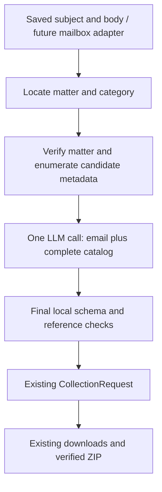

# Plan: rank requested UARB documents with one LLM call

Status: proposed; this document does not implement or invoke an LLM.
Starting point: `2f490a5`, with verified priority-driven downloads and ZIP creation.
This decision supersedes the separate intent-extraction/ranking workflow in
`document-selection-plan.md`. Email intake and delivery remain last.

## Decision and boundaries

Use one model request to interpret the user's email and select/rank documents
from an observed UARB catalog. There is no intermediate LLM intent object, second
ranking call, model-driven tool loop, or human approval step. Retain one local
execution-boundary check before constructing the existing `CollectionRequest`.

For an eligible job, make exactly one generation request. Jobs with missing
scope, an incomplete/oversized catalog, no public candidates, or missing model
configuration can finish with zero calls and an explicit outcome. Disable SDK
automatic retries; a timeout, refusal, incomplete response, or invalid selection
must not cause a repair call, fallback model, or a first-10 substitution.



## 1. Accept email text without building mailbox integration

Add a local request file containing `subject` and `body_text`. A future mailbox
adapter will decode MIME/HTML and populate the same interface; sender/reply
addresses and message IDs remain transport metadata outside the model input.

Example (illustrative request, not live document metadata):

```json
{
  "subject": "Other Documents for M12205",
  "body_text": "Please send up to 10 Other Documents from M12205. Prioritize Board Orders, then compliance filings. Exclude confidentiality undertakings and prefer recent documents."
}
```

For initial development, the body contains the current request only. Keep quoted
thread history separate rather than silently treating previous requests as new
instructions. Mailbox authentication, polling, threading, and sending are outside
this milestone.

## 2. Resolve catalog scope without another LLM call

The model cannot rank real references before we know where to retrieve them.
Implement a small deterministic router that locates one `M[0-9]{5}` matter and
the explicitly named canonical UARB category in the current subject/body. Accept
case-insensitive names and deduplicate repeated mentions; do not infer semantic
subtypes, exclusions, dates, preference tiers, or quantity here.

Provide explicit CLI routing fields for local testing and requests whose natural
language scope cannot be resolved mechanically. A later email adapter can supply
equivalent structured routing fields. Contradictory explicit routing and obvious
email scope must produce a scope error, not silently override the email.

| Input situation | Action before calling the model |
|---|---|
| One clear matter and category | Fetch that category's catalog |
| An explicit category list in routing fields | Fetch those categories, sharing one global limit of 10 |
| Missing/multiple matters, missing/ambiguous category scope | Return a clarification question; do not guess or invoke a second model |
| Only a subtype such as "orders," without a UARB category | Request category/routing scope; do not assume Key Documents |

Free-form category negation or conflicting category mentions are not mechanically
reliable routing instructions; require explicit scope in those cases. The router
is deliberately narrow. General semantic interpretation of missing catalog scope
would require a different design (another model turn or broader catalog reads),
so it is not silently added to the single-call architecture.

## 3. Build a complete catalog, without downloading documents

Reuse verified matter search/metadata/counts in `probe.py`, and extend the
category/virtual-scroll operations in `retrieval.py` with catalog enumeration.
The current `find_document()` locates a known reference; it is not a complete
catalog exporter.

For each row, capture:

- An opaque job-local `candidate_id` and its canonical download reference.
- Matter/category, displayed number or hearing date, title or witness fields.
- Displayed document date, extension, security label, and listing position when
  those fields exist; retain raw text and mark unavailable values explicitly.
- Whether the row can be uniquely addressed by the current downloader.

Scope enumeration to the verified matter and requested categories. Traverse all
virtual rows, deduplicating recycled DOM observations using stable row/reference
data and list positions. A list position proves snapshot coverage; it must not
become the document's download identity. Repeated hearing dates are distinct rows
and need distinguishing title/witness information.

Reconcile per-category row coverage with the live counts before selection, then
mark private or unaddressable rows ineligible. Preserve all five category counts
independently of eligibility. Duplicate numeric references across categories
must not become two downloadable selections. If the list changes during
enumeration, identifiers conflict, or coverage cannot be established, report
`catalog_incomplete` and stop before the model call.

Persist the full catalog and its fingerprint. Give the model a compact catalog
of eligible, uniquely addressable rows with the original metadata. Confirm new
field selectors from the live site; do not invent dates/extensions for layouts
that do not expose them.

## 4. Make the single structured model request

The first provider adapter will use OpenAI Responses with strict JSON Schema in
`text.format`. Keep the model name configurable and select a model supporting
that schema during implementation. The official documentation describes this
response format and the need to handle refusals/incomplete responses separately:
[Structured Outputs](https://developers.openai.com/api/docs/guides/structured-outputs).

Use the official Python SDK as an optional LLM dependency. Keep ordinary
inspection/download commands usable without it, and preserve lazy imports.
Use a server-side API key from configuration, an explicit request timeout, and
bounded output. Do not introduce an agent framework, embeddings store, or database.

Supply fixed instructions separately from the email and catalog data. In the
same call, the model must:

1. Interpret quantity, requested order, exclusions, dates/topics, and whether
   "only" or "prefer" allows other eligible documents.
2. Match those instructions against supplied candidate metadata.
3. Return at most the requested limit (maximum 10), in preferred order, with a
   concise selection reason and matching metadata evidence for each candidate.
4. Return a clarification or no-match outcome when appropriate. A vague title
   is not proof of document contents; do not invent full-text knowledge.

Example response shape (opaque IDs are illustrative):

```json
{
  "status": "ready",
  "matter_number": "M12205",
  "categories": ["Other Documents"],
  "limit": 10,
  "ranked_documents": [
    {"candidate_id": "c0017", "reason": "Matches the first requested type: Board Order", "matched_text": "Board Order"},
    {"candidate_id": "c0004", "reason": "Matches the next requested type: compliance filing", "matched_text": "Compliance Filing"}
  ],
  "clarification_question": null
}
```

The status enum is `ready`, `needs_clarification`, or `no_matches`. Define all
schema fields explicitly, reject additional fields, and use a nullable question
for the non-ready branches. For `ready`, require a nonempty ranking and no
clarification question; other statuses must not contain downloadable selections.

The model outputs candidate IDs rather than constructing filenames, URLs, or
UARB identifiers. Ordered results become priorities 1, 2, 3, and so on; Python
does not rerank them. If the user supplies no preference beyond category, use a
disclosed newest-first tie-break with stable reference ordering; unknown dates
sort after known dates. Exact requested references take precedence over soft
preferences but do not override exclusions or category scope. Fewer than ten
eligible matches is a valid result; "only" must not be padded with other types.

Check the full serialized request against a configured conservative input budget
before submission, reserving room for output. If the entire eligible catalog
does not fit, report `ranking_capacity_exceeded`. Do not silently truncate it,
rank just the first screen, summarize it with another model, or split it into
multiple model requests. Do not enable automatic context truncation. Document
the resulting capacity limit for the chosen model.

## 5. Perform one final execution-boundary check

After the model returns, check its completion/refusal state, parse its structured
output, and validate the final selection locally:

- Matter matches the verified matter; selected categories stay within scope.
- Candidate IDs exist in this catalog, are eligible, and are not repeated.
- Canonical document references remain unique under `CollectionRequest` rules.
- Selection length is within the returned requested limit and the hard cap of 10.
- Matching-text evidence is present in the referenced candidate metadata.
- Status, question, and ranking fields form a consistent ready/non-ready result.

Schema/reference checks cannot prove that the model correctly understood every
email phrase. Preference/exclusion interpretation is evaluated with labelled
examples and inspected live results; do not present schema adherence as semantic
correctness or use the model's confidence score as proof.

Map each accepted candidate back to its recorded canonical fields, assigning its
array position as priority. Build `CollectionRequest.from_dict()` and reuse the
existing downloader and ZIP path. Reasons/audit fields stay outside that strict
request object. No intent-validation round trip or additional model call occurs.

Initially, cataloging and downloading can use separate browser sessions. Carry
the verified scope and observed references forward; bind titles/witness labels
where supported and reverify rows during retrieval. Missing/changed references
use the current explicit failure/partial-ZIP behavior. Do not ask the model to
rank replacements or silently substitute unselected documents.

## Implementation milestones

| Step | Files and reviewable result |
|---|---|
| 1. Define input and output contracts | New `selection.py`: local subject/body input, narrow scope routing, candidate/result models, final mapping to existing `CollectionRequest` |
| 2. Export the catalog | New `catalog.py` using existing browser helpers; full category enumeration with completeness and eligibility evidence |
| 3. Add the one-call adapter | New `llm.py`: configurable OpenAI client, schema/prompt version, one generation request, retries disabled, explicit non-ready/error handling |
| 4. Connect local CLI execution | Add an LLM request-file mode with plan-only output by default; an explicit execute option passes an accepted selection to the existing collector |
| 5. Verify model selection quality | Offline integration tests and a small labelled request/catalog evaluation set; opt-in live catalog/model/download acceptance |
| 6. Document operation | README setup/configuration, sample request, saved evidence, optional dependency instructions; email intake/delivery still deferred |

Plan-only mode makes the exact generated collection request reviewable without
downloading files. It is a development capability, not a mandatory approval gate.
The normal application entry can execute a valid ready result automatically.
Mail integration later only replaces the saved subject/body source and consumes
the existing result/ZIP; it does not add another model stage.

## Verification and completion gates

- Offline tests cover scope routing, complete virtual-list traversal (including
  preferred rows beyond the first viewport), repeated date rows, private entries,
  cross-category duplicates, and incomplete/oversized catalogs.
- Assert one generation/HTTP attempt for an eligible job, including simulated
  provider errors; assert zero on preflight failures. Test that SDK retries,
  repair prompts, tool loops, and chunked ranking cannot add hidden calls.
- Test unknown/duplicate IDs, invalid limits, matter/scope mismatches, inconsistent
  statuses, nonexistent matching evidence, refusals, malformed/incomplete output,
  and network timeouts. All must leave no new download request executable.
- Labelled examples test orders before compliance filings, "only" versus
  "prefer," exclusions/negation, smaller quantities, recency, no matches, vague
  titles, and unrelated instructions embedded in email/catalog text. Judge
  acceptable relevance/tiers rather than one arbitrary order for equivalent rows.
- One live acceptance request must select a relevant offscreen candidate ahead
  of less relevant initial rows, preserve its reasons and canonical references,
  and reuse verified collection/ZIP handling with no more than 10 files.
- Save model/configuration and prompt/schema versions, catalog fingerprint,
  response ID/usage/latency when available, ranking, final collection request,
  and outcomes under ignored artifacts. Exclude credentials, mailbox transport
  metadata, raw email, and model-response audit files from the delivery ZIP.
- Keep the existing 154-test collection regression suite green. No API calls are
  needed for ordinary offline tests; live model calls require configured access.

This plan is complete when those gates demonstrate one-call ranking feeding the
existing downloader. Semantic request extraction in a separate model call,
mailbox setup, outbound email, PDF-content ranking, OCR, and audio transcription
are outside this milestone.
